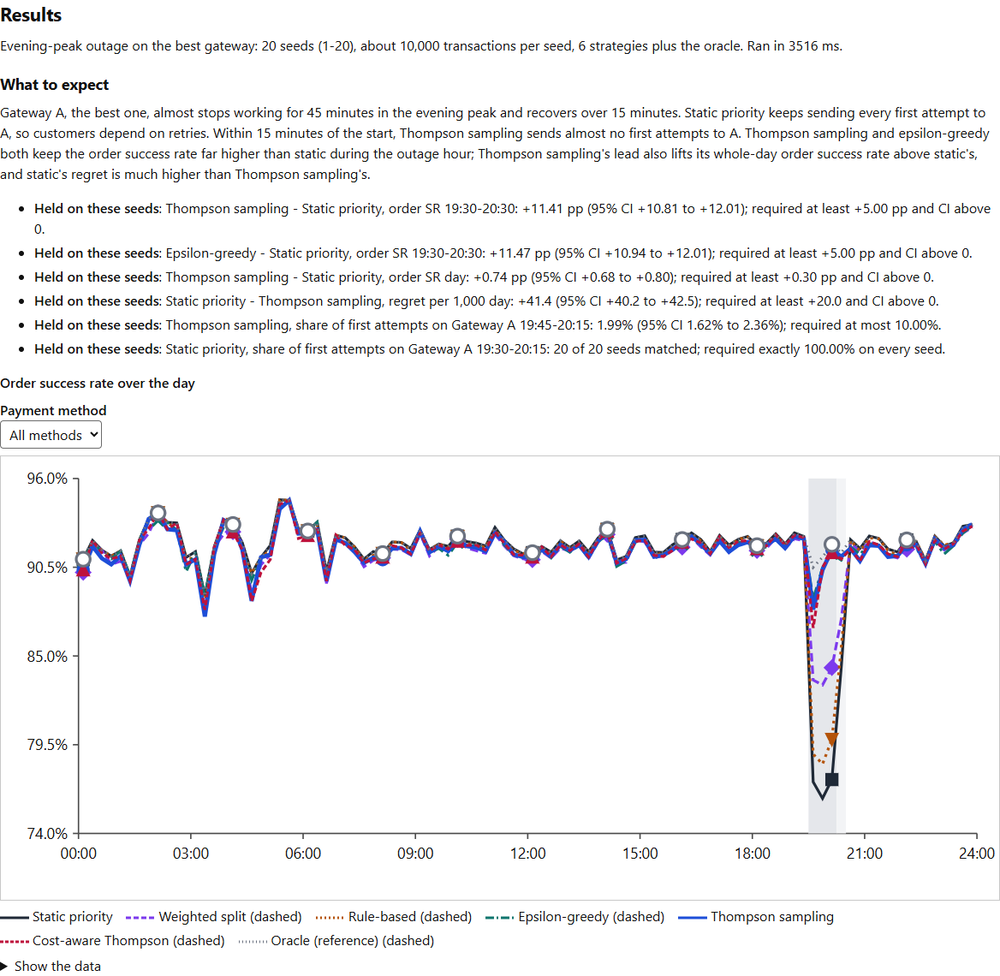
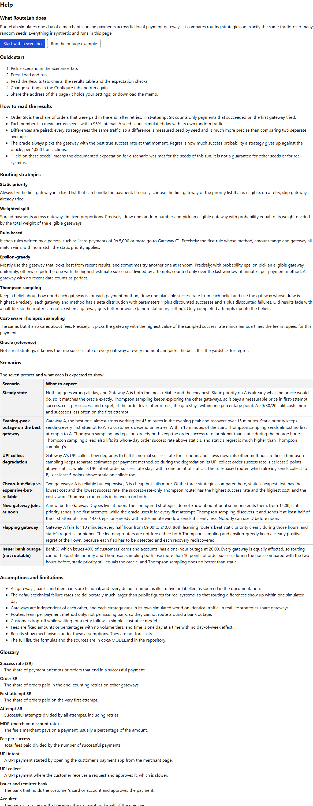
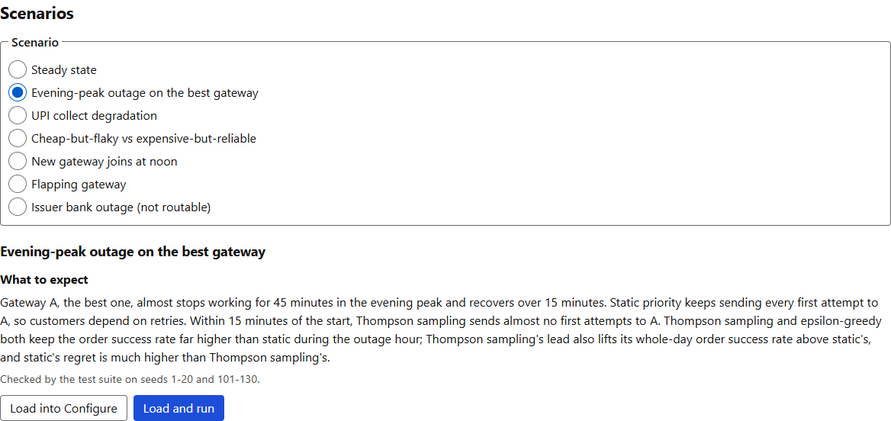
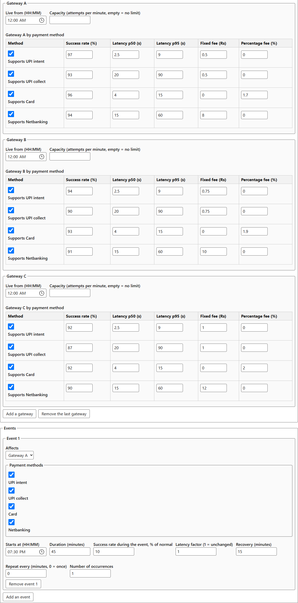
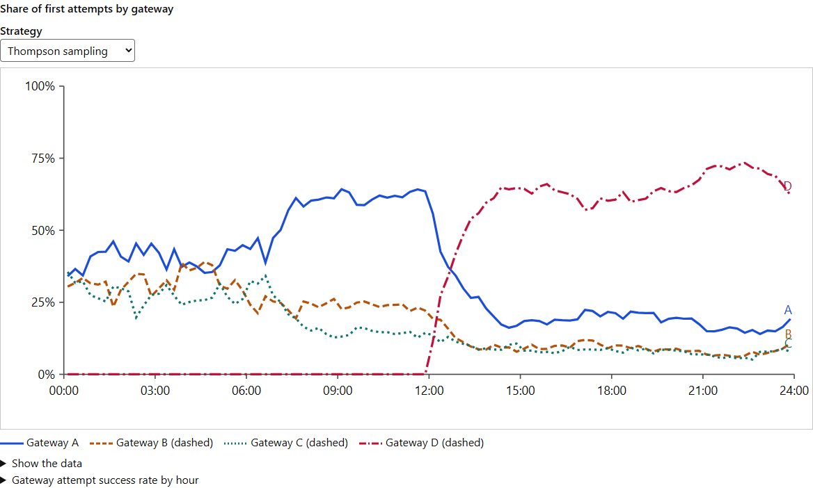
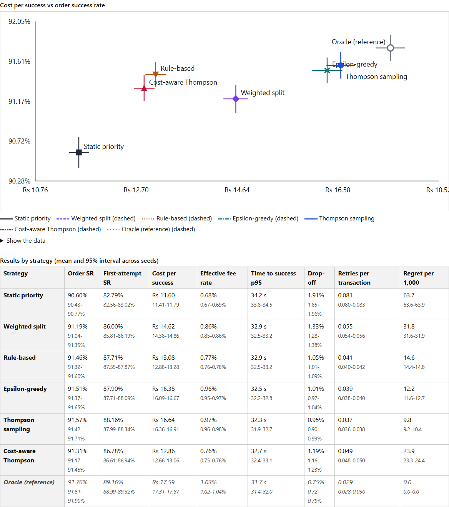
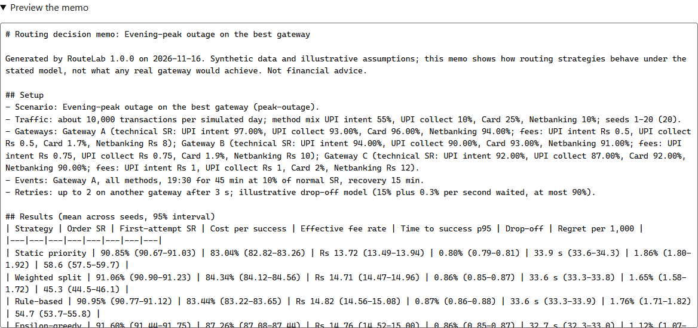

# RouteLab

A browser-only simulator that compares payment-routing strategies, from static priority to Thompson-sampling bandits, on synthetic UPI, card and netbanking traffic.

> Illustrative results: every number comes from a model with stated assumptions, not from real payment data. It shows how routing strategies behave, not what real gateways will do.


Synthetic data.

## Live demo

Live demo: https://github.com/AnirudhKaushik0211/routeLab

## Contents

1. [What it is and why](#what-it-is-and-why)
2. [Not a forecast, not financial advice](#not-a-forecast-not-financial-advice)
3. [Use it online](#use-it-online)
4. [Screenshots](#screenshots)
5. [Use it offline](#use-it-offline)
6. [Scenarios and results](#scenarios-and-results)
7. [Routing strategies explained](#routing-strategies-explained)
8. [How the simulation works](#how-the-simulation-works)
9. [Assumptions and limitations](#assumptions-and-limitations)
10. [Performance](#performance)
11. [Deploy your own copy on GitHub Pages](#deploy-your-own-copy-on-github-pages)
12. [Privacy](#privacy)
13. [FAQ](#faq)
14. [For developers](#for-developers)
15. [Related work and sources](#related-work-and-sources)
16. [License](#license)

## What it is and why

An online merchant usually connects to more than one payment gateway. Each payment has to go somewhere, and the choice matters: gateways differ in success rate, speed and fees, and their performance changes during the day. A gateway can slow down at the evening peak, one payment method can degrade while the others are fine, or a new gateway can go live. The rule that picks a gateway for each payment is the router.

RouteLab simulates one day of a merchant's payments across fictional gateways (Gateway A to Gateway E) and fictional issuing banks (Bank X, Bank Y, Bank Z). It runs several routers on exactly the same traffic: static priority, a weighted split, hand-written rules, epsilon-greedy, Thompson sampling and a cost-aware Thompson sampler. An oracle that knows the true success rates is the yardstick. Every run is repeated over many random seeds, so each result comes with a 95% interval and a paired comparison.

It comes in three forms that share the same code:

- a static web page that runs in your browser (no server, nothing uploaded);
- a Node.js library (`js/routelab.js`);
- a command-line tool (`scripts/simulate.cjs`).

What it is not: it is not a model of any real gateway, bank or merchant, it does not connect to anything, and it is not a production router.

## Not a forecast, not financial advice

Synthetic data and illustrative assumptions. Results show how routing mechanisms behave, not real-world success rates. Not financial advice.

Every default is illustrative or sourced; see docs/MODEL.md.

## Use it online

1. Open the live demo. The Help tab opens on your first visit and explains what you are looking at.
2. Go to Scenarios and pick a scenario, for example "Evening-peak outage on the best gateway".
3. Press "Load and run". The run takes a few seconds and the Results tab opens.
4. Read the results: the expectation checks, the success-rate chart over the day, the share of first attempts by gateway, the cost against success-rate scatter and the tables.
5. Change settings in Configure (gateways, events, retries, strategies) and press "Run with these settings".
6. Share the address of the page: it holds your settings, so the link reopens the same run.
7. Download the results as CSV or JSON, or download the routing decision memo in Markdown.

## Screenshots


Synthetic data.


Synthetic data.


Synthetic data.


Synthetic data.


Synthetic data.


Synthetic data.


Synthetic data.

## Use it offline

Download the ZIP from the repository's Releases page (or use Code > Download ZIP), extract it, and double-click `index.html`. The page works from the file system in current Edge, Chrome and Firefox, with no network connection.

## Scenarios and results

The table below is generated by `npm run results` from the 30 seeds 101-130. The "Expectations held" column counts the documented checks that held on those seeds and on the default seeds 1-20.

<!-- results:start -->
| Scenario | What happens | Headline on seeds 101-130 | Expectations held |
|---|---|---|---|
| Steady state | Nothing goes wrong all day, and Gateway A is both the most reliable and the cheapest. | Static priority - Thompson sampling, order SR (day): +0.25 pp (95% CI +0.23 to +0.27)<br>Static priority - Thompson sampling, first-attempt SR (day): +1.28 pp (95% CI +1.23 to +1.33) | 8/8 (seeds 101-130), 8/8 (seeds 1-20) |
| Evening-peak outage on the best gateway | Gateway A, the best one, almost stops working for 45 minutes in the evening peak and recovers over 15 minutes. | Thompson sampling - Static priority, order SR (19:30-20:30): +11.46 pp (95% CI +11.04 to +11.89) | 6/6 (seeds 101-130), 6/6 (seeds 1-20) |
| UPI collect degradation | Gateway A's UPI collect flow degrades to half its normal success rate for six hours and slows down; its other methods are fine. | Thompson sampling - Static priority, order SR (UPI collect) (10:00-16:30): +11.29 pp (95% CI +10.56 to +12.03) | 3/3 (seeds 101-130), 3/3 (seeds 1-20) |
| Cheap-but-flaky vs expensive-but-reliable | Two gateways: A is reliable but expensive, B is cheap but fails more. | Thompson sampling - Cost-aware Thompson, order SR (day): +0.26 pp (95% CI +0.23 to +0.29)<br>Thompson sampling - Cost-aware Thompson, cost per success (day): +Rs 3.81 (95% CI +Rs 3.71 to +Rs 3.91) | 6/6 (seeds 101-130), 6/6 (seeds 1-20) |
| New gateway joins at noon | A new, better Gateway D goes live at noon. | Thompson sampling, share of first attempts on Gateway D (14:00-24:00): 65.21% (95% CI 63.74% to 66.68%) | 6/6 (seeds 101-130), 6/6 (seeds 1-20) |
| Flapping gateway | Gateway A fails for 10 minutes every half hour from 09:00 to 21:00. | Thompson sampling - Static priority, order SR (09:00-21:00): +3.51 pp (95% CI +3.43 to +3.59) | 5/5 (seeds 101-130), 5/5 (seeds 1-20) |
| Issuer bank outage (not routable) | Bank X, which issues 40% of customers' cards and accounts, has a one-hour outage at 20:00. | Thompson sampling - Static priority, order SR (20:00-21:00): -0.10 pp (95% CI -0.15 to -0.04) | 4/4 (seeds 101-130), 4/4 (seeds 1-20) |
<!-- results:end -->

Full tables: [docs/RESULTS.md](docs/RESULTS.md). Assumptions and formulas: [docs/MODEL.md](docs/MODEL.md).

These numbers come from the model and its illustrative assumptions; they show mechanisms, not what any real gateway achieves.

## Routing strategies explained

Every strategy chooses among the eligible gateways: those that are live at that moment, support the payment method and, on a retry to another gateway, have not been tried yet for this payment. Ties go to the gateway that comes first in the static priority list.

**Static priority.** Use the first gateway in a fixed list. Precisely: the first gateway of the priority list that is eligible.

**Weighted split.** Spread payments in fixed proportions. Precisely: pick eligible gateway `g` with probability `w_g / sum of w over eligible gateways`; if all weights are 0, behave as static priority.

**Rule-based.** Hand-written if-then rules. Precisely: the first rule whose method (or "any"), amount range (`minAmount <= amount < maxAmount`) and gateway all match wins; with no match, static priority applies. The default rules include a deliberately stale belief (large card payments go to Gateway C) to show what out-of-date rules cost.

**Epsilon-greedy.** Mostly exploit, sometimes explore. Precisely: draw `u`; if `u < epsilon` pick an eligible gateway uniformly at random; otherwise pick the gateway with the highest estimate `a / (a + b)`, where `a` and `b` are the successes and failures of that gateway for this payment method within a sliding window of the last `W` minutes. A gateway with no data in the window counts as perfect (estimate 1), which makes the router try it.

**Thompson sampling.** Keep a belief per gateway and method, sample from it, use the best sample. Precisely: the belief is `Beta(1 + a, 1 + b)`. Old observations are discounted with a half-life `H`: before each read or update, `a` and `b` are multiplied by `2^(-(t - t_last) / H)`. A success adds 1 to `a` and a failure adds 1 to `b`. For each decision the router draws one `theta` from every eligible gateway's Beta and picks the largest. Discounting makes the router forget, which is what lets it notice a gateway getting worse or better (the success rates are non-stationary).

**Cost-aware Thompson sampling.** The same beliefs, but the score is `theta - lambda * fee`, where `fee` is the fee in rupees for this payment on that gateway. With `lambda = 0.01`, saving Rs 1 is worth 1 percentage point of success probability.

**Oracle and regret.** The oracle picks the eligible gateway with the highest true technical success probability at that moment. It is a reference, not a strategy you could deploy. Regret is, per first attempt that is not a customer-side decline, the true success probability of the best eligible gateway minus that of the chosen one, summed and reported per 1,000 transactions.

All learning routers learn per payment method only, and only from attempts that have completed (start time plus latency), so they never use information from the future.

## How the simulation works

- **Traffic.** Arrivals per minute are Poisson with an hourly shape that peaks in the evening. Each transaction has a method (UPI intent, UPI collect, card, netbanking), a lognormal amount and an issuing bank.
- **Customer-side vs technical declines.** As in public UPI statistics, a customer-side (business) decline such as a wrong PIN is drawn once per transaction: every gateway would decline it, it is never retried and it is not blamed on the gateway. Otherwise each attempt succeeds with the gateway's technical success probability times the bank's factor.
- **Events.** An event cuts a gateway's (or a bank's) success rate to a fraction of normal for a while, optionally for some methods only, with an optional linear recovery and repeats. Gateway events can also slow responses down.
- **Latency.** Response times are lognormal per gateway and method (p50 and p95 configurable).
- **Retries and drop-off.** After a technical failure the router can retry, by default up to twice on another gateway after 3 s. Before each retry the customer may give up, with a probability that grows with the time waited (an illustrative model).
- **Fees.** A successful payment costs a fixed fee plus a percentage of the amount; failed attempts cost nothing.
- **Discrete-event engine.** Attempts start and complete in simulated time. A router decides when an attempt starts and learns when it completes, so slow methods give slow feedback.
- **Common random numbers and paired comparisons.** Each transaction carries its own pre-drawn random numbers for up to four attempts, shared by every strategy. Each strategy runs in its own copy of the day on that same traffic, so differences come from decisions. Results are compared seed by seed (paired differences), which gives much narrower intervals than comparing two separate averages.
- **Seeds and intervals.** Each seed is one simulated day. Means across seeds come with 95% t-intervals. Default runs use seeds 1-20; the results above use seeds 101-130. Both seed sets and every expectation threshold were fixed before any run on them.

## Assumptions and limitations

Short form of docs/MODEL.md section 10:

- Not a forecast: every default is illustrative or labelled with its source.
- The default technical failure rates are deliberately much larger than public UPI ecosystem technical-decline figures, so that routing differences show up within one simulated day. The gaps between gateways are illustrative, not typical.
- Attempts are independent given their probabilities; real failures are correlated, which makes real retries less effective.
- Routers learn per payment method only, not per bank, card network or amount band.
- Outcomes are known exactly when an attempt completes; there are no pending states or late webhooks.
- Fees are charged only on success, with no tiers or monthly fees.
- Capacity limits are a hard per-minute cap; drop-off is a simple linear model.
- One merchant, one day, no seasonality, no fraud or risk declines.
- Each strategy runs in its own world; strategies tested side by side in real life share gateways.
- Hyperparameters are the same in every scenario and are not tuned.

The full list, the formulas and the sources: [docs/MODEL.md](docs/MODEL.md).

## Performance

The budget was fixed before any measurement (SPEC section 9). The default run is the unmodified "Evening-peak outage" preset: 7 policies, 20 seeds, about 10,000 transactions per seed.

| Id | Budget | Measured p95 | Result |
|---|---|---|---|
| P1 | Browser, click to results rendered, p95 <= 2,000 ms | Edge 157: 3,647 ms; Firefox 153: 4,086 ms | MISS |
| P2 | Longest main-thread slice <= 250 ms | Edge 157: 78 ms; Firefox 153: 72 ms | PASS |
| P3 | Node `simulate`, p95 <= 1,500 ms | Node 24: 2,809 ms | MISS |

Measured on the author's Windows laptop (Windows 11, Intel Core Ultra 5 235U, running on battery), 1 warm-up and 10 measured runs each. The first runs of each series took about 0.9 s in Node and 1.6-1.9 s in Edge; later runs were 2.5-3 times slower because the processor throttled under sustained load (a pure arithmetic loop slowed down by the same factor at the same point). P1 and P3 are therefore reported as misses on this machine.

`test/perf.test.cjs` checks P3 and is calibrated on the author's machine, so it may fail on slower machines. Skip it with `ROUTELAB_SKIP_PERF=1`: `set ROUTELAB_SKIP_PERF=1` in cmd, `$env:ROUTELAB_SKIP_PERF='1'` in PowerShell, or `ROUTELAB_SKIP_PERF=1 npm test` in POSIX shells.

## Deploy your own copy on GitHub Pages

1. Create a new repository on GitHub.
2. Upload the files (100 files or fewer per upload). Your file browser may hide `.nojekyll`; if it did not arrive, create it with Add file > Create new file (it is empty).
3. Settings > Pages > Deploy from a branch, branch `main`, folder `/ (root)`.
4. Wait 1-2 minutes. The address is `https://<your-user-name>.github.io/<repository-name>/`.

## Privacy

No network requests (blocked by a Content Security Policy and checked by automated tests). No analytics and no cookies. The browser's local storage holds one flag that remembers you have seen the Help tab. The address bar holds your settings after the `#`: browsers do not send that part to a server, but anyone you give the link to can read the settings.

## FAQ

**Is this how real gateways perform?** No. The gateways are fictional and the default failure rates are deliberately exaggerated so that differences show within one simulated day. The scenarios show mechanisms, such as how fast a router reacts to an outage, not real numbers.

**Why does Thompson sampling lose in steady state?** When nothing changes and the first gateway in the static list is already the best and cheapest, static priority is optimal. Thompson sampling keeps sending some payments to the other gateways to check them, which costs first-attempt success, fees and regret.

**Why does it keep exploring?** Its beliefs are discounted, so they never become certain. That keeps it ready for change, at a price when nothing changes.

**Why discounting or a window?** Gateway performance is non-stationary. A router that remembers everything reacts slowly to an outage and even more slowly to the recovery. A half-life (Thompson sampling) or a sliding window (epsilon-greedy) lets old evidence fade.

**Why does routing not fix a bank outage?** When the customer's bank fails, every gateway fails with it. The "Issuer bank outage" scenario shows that no router does better than static priority there.

**Why is the oracle not truly optimal?** It is greedy on the current success probability. It ignores fees, capacity and drop-off, so a cleverer policy could sometimes beat it on cost or overall success. It is a yardstick for routing knowledge, not an upper bound on everything.

**Why paired comparisons and intervals?** One simulated day is noisy. Running every strategy on the same traffic and comparing seed by seed removes most of that noise, and the interval says how sure the comparison is.

**How would I test a router in production?** With a controlled experiment that has guardrails on cost, latency and duplicate charges. Because strategies running side by side share gateways and capacity, switchback designs (alternating the router over time slots) are often better than splitting by customer.

**Can I name real gateways?** No. Names are fixed to Gateway A-E and Bank X-Z, so shared links and screenshots never look like statements about real companies.

**Why are the gateway names fixed?** For the same reason, and because element ids and links are derived from them.

**Why classic scripts and no Web Worker?** Browsers refuse ES modules and Web Workers loaded from `file://`, which would break double-click use. The simulation runs on the main thread in 30 ms slices so the page stays responsive.

**Does anything leave my browser?** No. The page makes no network requests, and the Content Security Policy blocks them.

## For developers

Requirements: Node.js 22 or newer for the tooling and the CLI only. Zero dependencies: no npm install is needed.

File layout:

```
index.html, css/app.css   the page
js/*.js                   simulation core (UMD, shared by browser, library, CLI and tests) and js/ui.js
scripts/simulate.cjs      command-line interface
scripts/results.cjs       docs/RESULTS.md, docs/results.json and the README results block
scripts/*.cjs             benchmarks, smoke test, screenshots, deny-list, self-scan, packaging
test/*.test.cjs           Node built-in test runner
docs/                     PRD, SPEC, MODEL, RESULTS, CASE-STUDY, screenshots
```

Library (Node):

```js
const RouteLab = require('./js/routelab.js');
const config = RouteLab.getScenario('peak-outage');
const results = RouteLab.simulate(config, { scenarioId: 'peak-outage', seeds: 20, seedStart: 1 });
console.log(results.summary.thompson.orderSr.mean, results.expectations.map(e => e.id + ' ' + e.held));
```

Library (browser console on the page): `RouteLab.simulate(RouteLab.getScenario('flapping'), { seeds: 5 })`. Other members: `validateConfig`, `createRunner` (step-wise runs), `toJson`, `toCsv`, `buildMemo`, `encodeState`, `decodeState`, `scenarios`, `RESULTS_SEEDS`, `ROBUST_SEEDS`.

Command line:

```
node scripts/simulate.cjs --list
node scripts/simulate.cjs --scenario peak-outage --seeds 20
node scripts/simulate.cjs --scenario cost-vs-sr --format memo --out memo.md
node scripts/simulate.cjs --config my-config.json --scenario steady --format json
node scripts/simulate.cjs --scenario flapping --assert
```

Exit codes: 0 success; 1 file, configuration or write error; 2 bad arguments; 3 with `--assert` when an expectation did not hold.

Results generator: `npm run results` runs every preset on seeds 101-130 and 1-20 and rewrites `docs/results.json`, `docs/RESULTS.md` and the results block above; `npm run results -- --check` regenerates twice in memory and compares with the files.

Commands:

```
npm test
npm run results
npm run results -- --check
npm run simulate -- --scenario flapping --seeds 30
npm run bench
npm run bench:browser
npm run smoke
npm run screenshots
node scripts/package-public.cjs --generic-only
```

## Related work and sources

Payments context (structure and orders of magnitude only; RouteLab uses no real company's figures):

- [S1] National Payments Corporation of India (NPCI), "UPI Product Statistics" page, https://www.npci.org.in.
- [S2] Reserve Bank of India, Payment System Indicators and the Annual Report chapter on payment and settlement systems, https://www.rbi.org.in.
- [S3] NPCI, "UPI Ecosystem Statistics" page (remitter-bank approval, business-decline and technical-decline percentages), https://www.npci.org.in.
- [S4] Section 269SU of the Income-tax Act, 1961, and the related notification making MDR not applicable to prescribed electronic modes, including UPI, from 1 January 2020.
- [S5] Reserve Bank of India, circular on the rationalisation of the merchant discount rate for debit card transactions, December 2017.
- [S6] Hyperswitch, an open-source payment orchestrator, whose documentation describes rule-based, volume-split and success-rate-based routing, and describes auth-rate routing as a non-stationary multi-armed bandit with delayed feedback: https://docs.hyperswitch.io/explore-hyperswitch/workflows/intelligent-routing/auth-rate-based-routing (repository https://github.com/juspay/hyperswitch). Juspay's open-source Decision Engine for rule-based and success-rate-based gateway selection: https://github.com/juspay/decision-engine. Both are public open-source projects for production routing; RouteLab makes no claim about their performance.
- [S7] A Razorpay blog article on payment success-rate optimisation in India states that UPI's technical decline rate was about 0.8% as of November 2024: https://razorpay.com/blog/payment-success-rate-optimization-india/. RouteLab's defaults are deliberately much larger (see "Assumptions and limitations").

Methods:

- [R1] Thompson, W. R. (1933). On the likelihood that one unknown probability exceeds another in view of the evidence of two samples. Biometrika.
- [R2] Chapelle, O. and Li, L. (2011). An empirical evaluation of Thompson sampling. NeurIPS.
- [R3] Garivier, A. and Moulines, E. (2011). On upper-confidence bound policies for switching bandit problems. ALT.
- [R4] Raj, V. and Kalyani, S. (2017). Taming non-stationary bandits: a Bayesian approach. arXiv:1707.09727.
- [R5] Sutton, R. S. and Barto, A. G. (2018). Reinforcement Learning: An Introduction, 2nd ed., chapter 2.
- [R6] Russo, D. J., Van Roy, B., Kazerouni, A., Osband, I. and Wen, Z. (2018). A tutorial on Thompson sampling. Foundations and Trends in Machine Learning.
- [R7] Box, G. E. P. and Muller, M. E. (1958). A note on the generation of random normal deviates. Annals of Mathematical Statistics.
- [R8] Marsaglia, G. and Tsang, W. W. (2000). A simple method for generating gamma variables. ACM Transactions on Mathematical Software.
- [R9] Student (1908). The probable error of a mean. Biometrika; Abramowitz, M. and Stegun, I. A. (1964). Handbook of Mathematical Functions, 26.7.5.
- [R10] Bojinov, I., Simchi-Levi, D. and Zhao, J. (2023). Design and analysis of switchback experiments. Management Science.
- [R11] Law, A. M. (2015). Simulation Modeling and Analysis, 5th ed.
- [R12] Knuth, D. E. (1997). The Art of Computer Programming, vol. 2, 3rd ed.
- mulberry32 PRNG and the FNV-1a hash (both public domain).

RouteLab is an educational simulator and is not financial advice.

## License

MIT, see [LICENSE](LICENSE).
